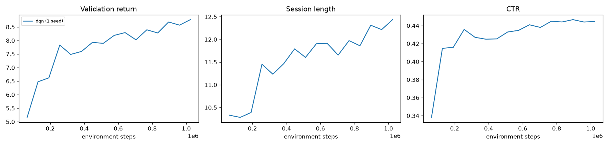

# slate-rl

Long-horizon **slate recommendation with deep RL**. Each turn, an agent recommends a slate of
items to a simulated user, and it is trained to maximise engagement over the whole session
(clicks, watch-through, diversity and novelty) instead of the next click.

The user simulator is learned from **MovieLens-1M**:
- a sequence encoder of the user's history
- a conditional-logit choice model that includes a no-click option
- latent fatigue and satisfaction states that decide when the user leaves the session

Agents include greedy-click, item-wise DQN, SlateQ and PPO with Wolpertinger-style
proto-actions.

> Status: work in progress. Milestones 1–5 (data pipeline, retrieval, simulator, environment, baselines + DQN) are done.

## Setup

Requires [uv](https://docs.astral.sh/uv/) and a W&B login (`uvx wandb login`).

```bash
make install   # uv sync + pre-commit hooks
make data      # download MovieLens-1M, index, split -> data/processed/ml-1m
make retrieval # train the two-tower model + FAISS index -> artifacts/retrieval/ml-1m
make simulator # train the simulator's choice model -> artifacts/simulator/ml-1m
make validate  # roll reference policies through the simulator -> reports/simulator/
make check-env # Gymnasium API check, an example episode, env throughput
make click-model  # log exploratory slates, fit the agent-side click model
make dqn       # train DQN (W&B curves; checkpoint selected on training-group users)
make evaluate  # baselines + agents on held-out users, with paired bootstrap CIs
make test
```

Pass `wandb.mode=disabled` to any script to run without W&B logging.

## Data

- **Chronological per-user split:** the last 10% of each user's ratings is test, the 10% before
  that is validation, and the rest is train.
- **Held-out users:** 10% of users are kept out entirely. They are used only for the final RL
  evaluation.
- **No popularity leakage:** item popularity is computed from model-group training data only.
- **Index 0 is padding:** real items are indexed from 1.
- **Modelling caveat:** MovieLens has no impressions or watch time. Watch-through is modelled from
  ratings, and unclicked impressions are sampled negatives. Results describe behaviour inside the
  simulator, not real users.

## Candidate retrieval (two-tower)

Each step, the agent chooses from K=100 candidates proposed by a two-tower model.
- **User tower:** encodes recent history plus demographics, with **no user-ID embedding**. This
  lets it work for held-out users and inside simulated sessions.
- **Item tower:** encodes item ID, genres and release year.
- **Training:** in-batch sampled softmax with logQ correction and duplicate-target masking.
- **Search:** exact inner-product search with FAISS.

Results on MovieLens-1M. Recall and NDCG count all of a user's next ratings in the split, with
already-seen items excluded:

| Model | Split | Recall@10 | Recall@100 | NDCG@10 | NDCG@100 |
|---|---|---|---|---|---|
| Popularity | test | 0.038 | 0.218 | 0.064 | 0.116 |
| Two-tower | test | 0.180 | 0.551 | 0.223 | 0.336 |
| Two-tower | held-out users, test | 0.182 | 0.545 | 0.219 | 0.330 |

Held-out users perform about as well as training users, so the history-based user tower
generalises to users it never saw.

## User simulator

Each simulated user has two parts:
- **Learned preferences:** a SASRec-style transformer reads the user's history. It is trained on
  MovieLens with a full-catalogue softmax (a conditional-logit choice model) plus a rating head.
- **Hand-set session dynamics:** a choice among the slate's items plus a *no-click* option,
  position bias, a **fatigue** state, a **satisfaction** state and a probability of leaving.
  - Fatigue rises when the user consumes items similar to what they just watched.
  - Satisfaction is a moving average of watch-through.
  - The leave probability goes up with fatigue and down with satisfaction.

Some design choices:
- **Comparable utilities:** utilities are expressed as *log-lift over uniform*,
  `log P(i) + log N`. Because a conditional logit has the IIA property, restricting choice to
  the slate stays consistent with the model fit on the whole catalogue.
- **Calibrated fatigue reference:** the similarity level at which fatigue neither rises nor falls
  is set from real data (the mean similarity between consecutive real consumptions).
- **Separate models:** the simulator has its own embeddings, separate from the retrieval model the
  agent uses.

The full report is in [reports/simulator/report.md](reports/simulator/report.md). Results on
held-out users:

| Policy | Session length | Watch / session | CTR at step 0 |
|---|---|---|---|
| Random (from candidates) | 10.4 | 1.88 | 0.27 |
| Retrieval greedy | 10.8 | 3.52 | 0.61 |
| Oracle greedy (simulator affinity) | 11.6 | 4.70 | **0.73** |
| Oracle novelty-aware | **13.6** | **5.73** | 0.72 |

Greedy wins on immediate CTR but loses on session length (−15%) and total watch (−18%) to a
policy that steers away from what the user just consumed. This is the long-term trade-off
the RL agents have to discover, and they must do it *without* access to the simulator's
affinity. The `oracle_*` rows exist only as probes.

**Limitations:**
- No impressions or watch time: everything except the learned affinity and rating model is
  hand-set.
- The rating head is compressed towards the mean (true 1★ → 2.7, 5★ → 3.9).
- Simulated consumption is slightly more popular and less genre-diverse than real consumption.

## Environment

`BatchedSlateEnv` steps N simulated users in parallel on the GPU and auto-resets finished
sessions. `SlateRecEnv` is a single-user Gymnasium wrapper; it passes
`gymnasium.utils.env_checker` and is used for the viewer and serving.

- **Observation:** only what a real recommender could know.
  - the user's recent history and their retrieval user embedding
  - K=100 candidates, each with its retrieval embedding, retrieval score, popularity, genres
    and similarity to the user's recent items
  - the recommender's own session log: progress, click-rate EMA, last click, last watch,
    no-click streak

  Simulator internals such as fatigue and satisfaction appear only in `info["sim"]`, for
  analysis.
- **Action:** k=5 distinct indices into the candidates. Duplicate indices are replaced by the
  lowest unused candidate and flagged in `info["action_fixed"]`.
- **Reward:** `click + watch + 0.1·ILD(slate) + 0.1·novelty(clicked) − 0.2·repeat`.
  - ILD is genre diversity within the shown slate.
  - Novelty counts only for *consumed* items, so showing obscure items nobody clicks earns
    nothing.
  - `repeat` is the share of the slate already shown earlier in the session.
  - Each component is reported separately in `info["reward_components"]`.
- **Episode end:** a user leaving is `terminated`; hitting the 50-step cap is `truncated`.
  `info["final_obs"]` supports bootstrapping on truncation.
- **Throughput:** about 22k user-steps/s on an M3 (MPS), and about 9k on CPU.

## Agents and results

All policies see only the environment's observation.
- **Baselines:** `random`, `popularity`, `retrieval` (two-tower order), `greedy_click` and `mmr`.
  - `greedy_click` ranks by the **agent's own click model**: a conditional logit with no-click
    and position bias, fit on 150k logged exploratory slates. It is calibrated (predicted CTR
    0.396 vs observed 0.388).
  - `mmr` is greedy-click relevance re-ranked for diversity in embedding space.
- **DQN (item-wise):**
  - Q(s, A) = mean of per-candidate q(s, i), and the slate is the top-5 by q.
  - Training uses double DQN, 3-step returns, Polyak targets and correct bootstrapping on
    truncation.
  - The replay buffer stores item ids plus the 2 dynamic features (about 1.3 KB per
    transition, versus about 34 KB for the full features).
  - It trains on about 1M environment steps in roughly 10 minutes on an M3.
  - The checkpoint is chosen on 1,024 *training-group* users. The 604 held-out users are used
    only for the final numbers below.

Held-out users, one session each, with the same users and seed for every policy:

| Policy | Return | Session length | Clicks | Watch | CTR | ILD |
|---|---|---|---|---|---|---|
| random | 4.92 | 10.5 | 2.66 | 1.87 | 0.253 | 0.692 |
| popularity | 4.22 | 11.0 | 2.88 | 2.24 | 0.262 | 0.730 |
| retrieval | 7.98 | 10.7 | 5.14 | 3.55 | 0.480 | 0.575 |
| greedy_click | 7.57 | 10.1 | 4.87 | 3.36 | 0.483 | 0.577 |
| mmr | **8.33** | 10.9 | 5.32 | 3.68 | **0.488** | 0.617 |
| dqn (1 seed) | 8.32 | **11.8** | 5.25 | **3.79** | 0.443 | **0.656** |

DQN's return relative to each baseline (paired bootstrap, 95% CI): **+0.76 [+0.30, +1.21]**
vs greedy_click, +0.34 [−0.11, +0.79] vs retrieval, −0.01 [−0.50, +0.47] vs mmr.

What DQN does differently from the click-maximiser:
- It **accepts a lower CTR (0.44 vs 0.48) in exchange for longer sessions and more watch
  time**. This is the long-term trade-off the simulator was designed to reward, and it beats
  greedy-click clearly.
- It does *not* yet beat MMR.
- It never learned to stop re-showing slates: about 74% of each slate was already shown,
  the same as the deterministic baselines.

The validation curve was still rising at 1M steps
([learning curves](reports/eval/learning_curves.png)). SlateQ, PPO, longer training and
multiple seeds come next.



## Layout

```
configs/    Hydra configs (data/, wandb/, ...)
slate_rl/   data/, retrieval/, simulator/, envs/, agents/, eval/, utils/
reports/    generated validation reports
scripts/    entry points
tests/
```
