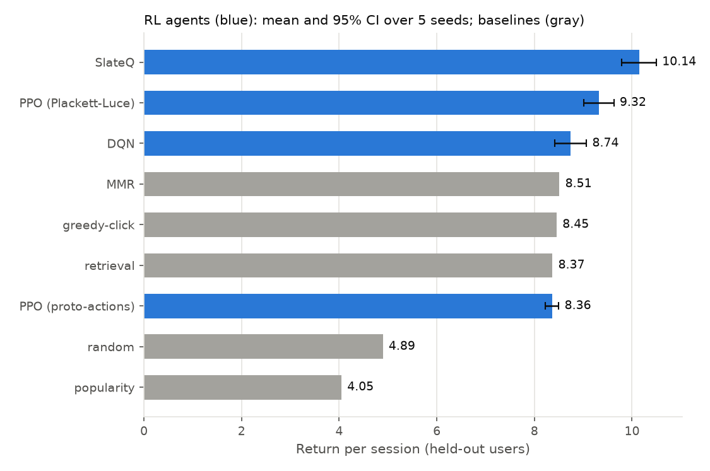
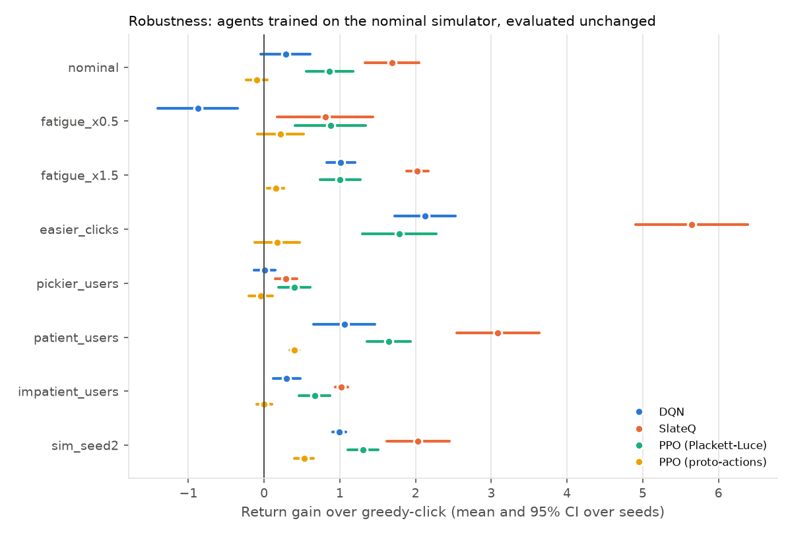

# slate-rl

Long-horizon **slate recommendation with deep RL**. Each turn, an agent recommends a slate of
items to a simulated user, and it is trained to maximise engagement over the whole session
(clicks, watch-through, diversity and novelty) instead of the next click.

The user simulator is learned from **MovieLens-1M**:
- a sequence encoder of the user's history
- a conditional-logit choice model that includes a no-click option
- latent fatigue and satisfaction states that decide when the user leaves the session

Agents include greedy-click, item-wise DQN, SlateQ and PPO with Wolpertinger-style
proto-actions.

> Status: work in progress. Milestones 1–9 are done: data pipeline, retrieval, simulator, environment, baselines, DQN, SlateQ, PPO, multi-seed + robustness evaluation, and the viewer/API/Docker demo.

## Setup

Requires [uv](https://docs.astral.sh/uv/) and a W&B login (`uvx wandb login`).

```bash
make install   # uv sync + pre-commit hooks
make data      # download MovieLens-1M, index, split -> data/processed/ml-1m
make retrieval # train the two-tower model + FAISS index -> artifacts/retrieval/ml-1m
make simulator # train the simulator's choice model -> artifacts/simulator/ml-1m
make validate  # roll reference policies through the simulator -> reports/simulator/
make check-env # Gymnasium API check, an example episode, env throughput
make click-model  # log exploratory slates, fit the agent-side click model
make dqn       # train DQN (W&B curves; checkpoint selected on training-group users)
make slateq    # train SlateQ (needs the click model)
make ppo       # train PPO with proto-actions (also: agent=ppo_pl, agent=ppo_naive)
make evaluate  # baselines + agents on held-out users, with paired bootstrap CIs
make seeds     # GPU recommended: train 5 seeds of every agent, 6 at a time
make evaluate-seeds  # multi-seed + robustness report -> reports/eval_seeds/
make trajectories    # export sessions for the viewer -> reports/trajectories/
make test
```

Pass `wandb.mode=disabled` to any script to run without W&B logging.

## Data

- **Chronological per-user split:** the last 10% of each user's ratings is test, the 10% before
  that is validation, and the rest is train.
- **Held-out users:** 10% of users are kept out entirely. They are used only for the final RL
  evaluation.
- **No popularity leakage:** item popularity is computed from model-group training data only.
- **Index 0 is padding:** real items are indexed from 1.
- **Modelling caveat:** MovieLens has no impressions or watch time. Watch-through is modelled from
  ratings, and unclicked impressions are sampled negatives. Results describe behaviour inside the
  simulator, not real users.

## Candidate retrieval (two-tower)

Each step, the agent chooses from K=100 candidates proposed by a two-tower model.
- **User tower:** encodes recent history plus demographics, with **no user-ID embedding**. This
  lets it work for held-out users and inside simulated sessions.
- **Item tower:** encodes item ID, genres and release year.
- **Training:** in-batch sampled softmax with logQ correction and duplicate-target masking.
- **Search:** exact inner-product search with FAISS.

Results on MovieLens-1M. Recall and NDCG count all of a user's next ratings in the split, with
already-seen items excluded:

| Model | Split | Recall@10 | Recall@100 | NDCG@10 | NDCG@100 |
|---|---|---|---|---|---|
| Popularity | test | 0.038 | 0.218 | 0.064 | 0.116 |
| Two-tower | test | 0.180 | 0.551 | 0.223 | 0.336 |
| Two-tower | held-out users, test | 0.182 | 0.545 | 0.219 | 0.330 |

Held-out users perform about as well as training users, so the history-based user tower
generalises to users it never saw.

## User simulator

Each simulated user has two parts:
- **Learned preferences:** a SASRec-style transformer reads the user's history. It is trained on
  MovieLens with a full-catalogue softmax (a conditional-logit choice model) plus a rating head.
- **Hand-set session dynamics:** a choice among the slate's items plus a *no-click* option,
  position bias, a **fatigue** state, a **satisfaction** state and a probability of leaving.
  - Fatigue rises when the user consumes items similar to what they just watched.
  - Satisfaction is a moving average of watch-through.
  - The leave probability goes up with fatigue and down with satisfaction.

Some design choices:
- **Comparable utilities:** utilities are expressed as *log-lift over uniform*,
  `log P(i) + log N`. Because a conditional logit has the IIA property, restricting choice to
  the slate stays consistent with the model fit on the whole catalogue.
- **Calibrated fatigue reference:** the similarity level at which fatigue neither rises nor falls
  is set from real data (the mean similarity between consecutive real consumptions).
- **Separate models:** the simulator has its own embeddings, separate from the retrieval model the
  agent uses.

The full report is in [reports/simulator/report.md](reports/simulator/report.md). Results on
held-out users:

| Policy | Session length | Watch / session | CTR at step 0 |
|---|---|---|---|
| Random (from candidates) | 10.4 | 1.88 | 0.27 |
| Retrieval greedy | 10.8 | 3.52 | 0.61 |
| Oracle greedy (simulator affinity) | 11.6 | 4.70 | **0.73** |
| Oracle novelty-aware | **13.6** | **5.73** | 0.72 |

Greedy wins on immediate CTR but loses on session length (−15%) and total watch (−18%) to a
policy that steers away from what the user just consumed. This is the long-term trade-off
the RL agents have to discover, and they must do it *without* access to the simulator's
affinity. The `oracle_*` rows exist only as probes.

**Limitations:**
- No impressions or watch time: everything except the learned affinity and rating model is
  hand-set.
- The rating head is compressed towards the mean (true 1★ → 2.7, 5★ → 3.9).
- Simulated consumption is slightly more popular and less genre-diverse than real consumption.

## Environment

`BatchedSlateEnv` steps N simulated users in parallel on the GPU and auto-resets finished
sessions. `SlateRecEnv` is a single-user Gymnasium wrapper; it passes
`gymnasium.utils.env_checker` and is used for the viewer and serving.

- **Observation:** only what a real recommender could know.
  - the user's recent history and their retrieval user embedding
  - K=100 candidates, each with its retrieval embedding, retrieval score, popularity, genres
    and similarity to the user's recent items
  - the recommender's own logs: progress, click-rate EMA, last click, last watch, no-click
    streak, and which candidates it has already shown this session

  Simulator internals such as fatigue and satisfaction appear only in `info["sim"]`, for
  analysis.
- **Action:** k=5 distinct indices into the candidates. Duplicate indices are replaced by the
  lowest unused candidate and flagged in `info["action_fixed"]`.
- **Reward:** `click + watch + 0.1·ILD(slate) + 0.1·novelty(clicked) − 0.2·repeat`.
  - ILD is genre diversity within the shown slate.
  - Novelty counts only for *consumed* items, so showing obscure items nobody clicks earns
    nothing.
  - `repeat` is the share of the slate already shown earlier in the session.
  - Each component is reported separately in `info["reward_components"]`.
- **Episode end:** a user leaving is `terminated`; hitting the 50-step cap is `truncated`.
  `info["final_obs"]` supports bootstrapping on truncation.
- **Throughput:** about 22k user-steps/s on an M3 (MPS), and about 9k on CPU.

## Agents and results

All policies see only the environment's observation.
- **Baselines:** `random`, `popularity`, `retrieval` (two-tower order), `greedy_click` and `mmr`.
  - `greedy_click` ranks by the **agent's own click model**: a conditional logit with no-click
    and position bias, fit on 150k logged exploratory slates. It is calibrated (predicted CTR
    0.390 vs observed 0.389).
  - `mmr` is greedy-click relevance re-ranked for diversity in embedding space.
- **DQN (item-wise):**
  - Q(s, A) = mean of per-candidate q(s, i), and the slate is the top-5 by q.
  - Training uses double DQN, 3-step returns, Polyak targets and correct bootstrapping on
    truncation.
  - The replay buffer stores item ids plus the dynamic features (about 1.3 KB per transition,
    versus about 34 KB for the full features).
- **SlateQ** (Ie et al., 2019):
  - `Q(s, A) = R_slate(s, A) + Σ_{i ∈ A ∪ {none}} P(i | s, A) · Q̄(s, i)`.
  - The choice model P is the agent's click model. Q̄ is learned by TD on the item the user
    actually clicked.
  - `R_slate` covers the slate-level reward terms (diversity, repeat). The agent computes them
    exactly from its observation; a test checks they match the env's reward.
  - Slates are built greedily, maximising Q(s, A) position by position.
- **PPO**, in three variants that share one PPO loop (clipped objective, GAE, LR annealing,
  value bootstrapping at truncation):
  - `ppo`, Wolpertinger-style proto-actions:
    - The actor outputs 5 points in the retrieval embedding space, sampled from a diagonal
      Gaussian. Each is mapped to its nearest unused candidate, so the policy never scores
      individual items.
    - The means are anchored at the user's retrieval embedding plus a residual that starts at
      zero, so the untrained policy *is* retrieval ranking.
    - Wolpertinger's re-scoring of the m nearest neighbours needs a Q(s, a) critic, so it is
      not used with PPO.
  - `ppo_naive`: the same, but with randomly initialised means and larger exploration noise.
  - `ppo_pl`, the control: a Plackett-Luce policy that scores each candidate and samples a
    ranked slate with exact log-probabilities (Gumbel top-k).
- **Training budget:** 1M environment steps per agent, about 10 minutes on an M3. The
  checkpoint is chosen on 1,024 *training-group* users; the 604 held-out users are used only
  for the numbers below.

### Results: 5 training seeds, 604 held-out users

Every policy is evaluated on the same held-out users with the same evaluation seed. For the
RL agents, the intervals are 95% t-intervals across 5 training seeds. The baselines are
deterministic and are evaluated once. The full report is in
[reports/eval_seeds/report.md](reports/eval_seeds/report.md).

| Policy | Return | Session length | Watch | CTR | ILD | Repeat |
|---|---|---|---|---|---|---|
| **SlateQ** | **10.14** [9.79, 10.50] | **13.13** | **4.41** | 0.447 | **0.726** | 0.526 |
| PPO (Plackett-Luce) | 9.32 [9.01, 9.63] | 11.74 | 3.97 | 0.478 | 0.629 | 0.544 |
| DQN | 8.74 [8.41, 9.06] | 11.86 | 3.62 | 0.422 | 0.647 | **0.383** |
| MMR | 8.51 | 11.20 | 3.78 | 0.486 | 0.619 | 0.750 |
| greedy-click | 8.45 | 11.09 | 3.75 | **0.491** | 0.585 | 0.753 |
| retrieval | 8.37 | 11.12 | 3.67 | 0.487 | 0.579 | 0.741 |
| PPO (proto-actions) | 8.36 [8.22, 8.50] | 11.10 | 3.66 | 0.485 | 0.592 | 0.732 |
| random | 4.89 | 10.68 | 1.85 | 0.250 | 0.683 | 0.234 |
| popularity | 4.05 | 10.90 | 2.16 | 0.255 | 0.738 | 0.838 |



### Robustness to a changed simulator

Agents are trained on the nominal simulator and then evaluated, unchanged, against:
- fatigue that is half or 1.5× as strong
- users who click more easily, or are pickier
- users who are more patient, or less patient (they leave later or sooner)
- **a second simulator**: the same dynamics, but preferences learned by a choice model
  retrained from a different seed

The table shows each agent's return gain over greedy-click (mean and 95% CI over 5 seeds):

| Scenario | SlateQ | PPO (Plackett-Luce) | DQN | PPO (proto) |
|---|---|---|---|---|
| nominal | **+1.69** [+1.34, +2.04] | +0.86 [+0.56, +1.17] | +0.28 [−0.04, +0.61] | −0.10 [−0.23, +0.04] |
| fatigue ×0.5 | +0.81 [+0.17, +1.44] | **+0.88** [+0.41, +1.34] | −0.88 [−1.40, −0.35] | +0.22 [−0.09, +0.52] |
| fatigue ×1.5 | **+2.02** [+1.88, +2.16] | +1.00 [+0.74, +1.27] | +1.01 [+0.82, +1.20] | +0.15 [+0.05, +0.26] |
| easier clicks | **+5.64** [+4.90, +6.39] | +1.78 [+1.30, +2.27] | +2.13 [+1.73, +2.53] | +0.17 [−0.12, +0.47] |
| pickier users | +0.29 [+0.15, +0.43] | **+0.40** [+0.19, +0.61] | +0.01 [−0.13, +0.15] | −0.04 [−0.20, +0.11] |
| patient users | **+3.09** [+2.54, +3.63] | +1.65 [+1.36, +1.94] | +1.06 [+0.65, +1.47] | +0.40 [+0.34, +0.46] |
| impatient users | **+1.02** [+0.94, +1.10] | +0.67 [+0.46, +0.87] | +0.30 [+0.12, +0.48] | +0.00 [−0.10, +0.10] |
| second simulator | **+2.03** [+1.62, +2.44] | +1.30 [+1.10, +1.51] | +0.99 [+0.91, +1.08] | +0.53 [+0.40, +0.65] |



### What the results show

- **SlateQ is the best policy, and the lead is robust.**
  - It beats every baseline and every other agent on the nominal simulator, and it beats
    greedy-click in all 8 scenarios.
  - It wins by modelling how the items in a slate compete for a single click. It accepts a
    lower CTR (0.45 vs 0.49) in exchange for sessions that are 18% longer and 18% more watch
    time, which is the long-term trade-off the simulator was built to reward.
  - Its advantage *grows* when that trade-off is stronger: easier clicks, patient users, or
    stronger fatigue.
- **PPO with a Plackett-Luce policy is a solid second.** It is positive in all 8 scenarios
  and is the most robust when fatigue is weak or users are picky.
- **DQN only ties the baselines across seeds** (+0.28 [−0.04, +0.61] vs greedy-click).
  - A single-seed run in milestone 6 had suggested a significant win. Five seeds show that
    was partly luck, which is exactly why multi-seed evaluation matters.
  - DQN also *loses* to greedy-click when fatigue is halved (−0.88). It seems to over-learn
    "avoid similar items" in a world where that matters less.
- **How PPO's action space is parameterised decides whether it works.**
  - *Naive* proto-actions fail outright (3.74, below random). With random initialisation
    and noise about 3× a coordinate of the 64-d unit embeddings, the nearest-neighbour map
    produces near-random slates and the gradient carries no signal.
  - Anchoring the proto-actions at the user embedding makes the policy start as retrieval
    ranking, but over 5 seeds it never moves away from it (8.36 vs retrieval 8.37).
  - Scoring the 100 candidates directly (Plackett-Luce) works far better.
  - Proto-actions are meant for catalogues too large to score item by item; with K=100 they
    pay only the cost.
- **The agents need to see their own impressions.** An earlier version of the observation
  hid which candidates had already been shown. With it, DQN re-showed about 74% of each
  slate, like the fixed baselines. With the impression feature, its repeat share is 0.38.
- **Evaluation noise is real.** The same baselines scored about 0.4 lower in milestones 5–7,
  which were evaluated on the Mac (MPS) instead of a CUDA GPU. Different random-number
  streams mean different simulated users' choices. This is why every number above comes
  from one paired evaluation run.

**Compute:**
- Milestones 1–7 ran on an M3 MacBook Air.
- Milestone 8 (16 more training runs, a second simulator, 8 robustness scenarios) ran on a
  rented RTX 3090 in about 30 minutes of compute (six runs at a time), within roughly an
  hour of pod time including setup.
- The full pipeline can be rerun on a GPU machine with:
  `bash scripts/remote/setup.sh && bash scripts/remote/milestone8.sh`.
- Learning curves for seed 0 are in
  [reports/eval/learning_curves.png](reports/eval/learning_curves.png).

## Demo: viewer, API, Docker

```bash
docker compose up --build   # viewer: http://localhost:8501 · API docs: http://localhost:8000/docs
```

Without Docker, run `make api` and `make viewer` in two terminals. The viewer reads the
committed `reports/`, so session replay and results work without any trained artifacts.

**Viewer (Streamlit):**
- **Session replay:** pick a held-out user and two policies, then step through both
  sessions side by side.
  - The clicked movie is highlighted with its watch fraction, and re-shown items are marked.
  - Charts show cumulative reward plus the simulator's hidden fatigue and satisfaction.
  - Users are listed by id by default. Sorting by the biggest gap is an explicit option,
    since extremes include luck in when users leave.
- **Results:** the multi-seed and robustness figures, plus a table of mean return per
  scenario.
- **Live session:** runs a brand-new simulated session through the API.

**API (FastAPI):**

| Endpoint | Purpose |
|---|---|
| `GET /policies` | All baselines and trained agents (seed 0) |
| `POST /recommend` | A slate from any policy, given a viewing history |
| `POST /simulate` | One simulated session for a held-out user, step by step |
| `GET /health` | Health check |

`POST /recommend` takes `history_movie_ids` (MovieLens ids) and, optionally, `shown_movie_ids`
(impressions earlier in the session), `step` and `demographics`. Requests go through the
same `build_observation` function the agents were trained on.

```bash
curl -X POST localhost:8000/recommend -H 'content-type: application/json' \
  -d '{"policy": "slateq", "history_movie_ids": [260, 1196, 1210, 2571, 1240, 589, 1580]}'
# Star Wars IV-VI, The Matrix, Terminator 1-2, Men in Black ->
# Total Recall, Back to the Future, Close Encounters, E.T., Jurassic Park
```

**Images:**
- The API image installs CPU-only PyTorch (CUDA wheels are filtered out of the lock export).
  The trained artifacts and processed data are mounted read-only.
- The viewer image has no PyTorch.

## Layout

```
configs/    Hydra configs (data/, wandb/, ...)
slate_rl/   data/, retrieval/, simulator/, envs/, agents/, eval/, serving/, utils/
viewer/     Streamlit app
docker/     API and viewer images (docker-compose.yml at the root)
reports/    generated validation reports
scripts/    entry points
tests/
```
