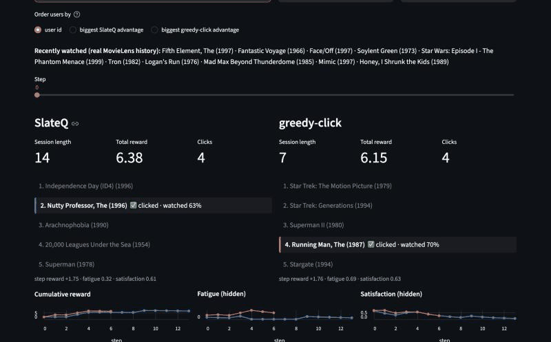
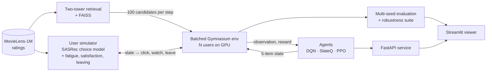

# slate-rl

**Long-horizon slate recommendation with deep RL, in a user simulator learned from
MovieLens-1M.** Each turn an agent shows a simulated user 5 movies, the user clicks one or
none, and the agent is trained to maximise engagement over the *whole session* instead of
the next click.


**Key results** (604 held-out users, 5 training seeds per agent):
- **SlateQ wins:** return **10.14 [9.79, 10.50]** vs **8.45** for a greedy click-maximiser
  (+20%). It accepts a slightly lower CTR in exchange for sessions **18% longer** with **18%
  more watch time**, and it stays ahead in **all 8** robustness scenarios, including a
  simulator retrained from a different seed.
- **PPO's action space decides whether it works:**
  - Wolpertinger-style proto-actions fail when naively initialised (below random).
  - Anchored at the user embedding, they only match retrieval.
  - A Plackett-Luce policy over the candidates reaches 9.32.
- **DQN only ties the baselines across seeds.** A single seed had suggested a clear win, and
  the README reports the correction.



*The viewer replaying a typical held-out user: their SlateQ-vs-greedy-click gap is the median
across 100 users. Greedy-click keeps re-showing the same titles, its hidden fatigue climbs,
and the user leaves after 7 steps. SlateQ diversifies and keeps the user for 14 steps.*

---

- [How it works](#how-it-works)
- [Results](#results)
- [Try it](#try-it)
- [Reproduce everything](#reproduce-everything)
- [Design decisions](#design-decisions)
- [Components in detail](#components-in-detail)
- [Limitations](#limitations)
- [Project layout](#project-layout) · [References](#references)

## How it works



1. **Retrieval:** a two-tower model narrows 3,706 movies to 100 candidates per step.
2. **Simulator:** each simulated user combines learned preferences with hand-set session
   dynamics.
   - The preferences come from a SASRec-style transformer trained on MovieLens, which is a
     conditional-logit choice model.
   - The dynamics: a no-click option, position bias, **fatigue** that rises when the user
     consumes similar items, **satisfaction**, and a probability of leaving.
3. **Environment:** thousands of users are stepped in parallel on the GPU, at about 22k
   user-steps/s on an M3.
   - The reward is `click + watch + 0.1·diversity + 0.1·novelty − 0.2·repeat`.
4. **Agents:** five baselines, item-wise DQN, SlateQ and three PPO variants. They see only
   what a real recommender could know, never the simulator's internals.
5. **Evaluation:** paired comparisons on held-out users, 5 seeds, and 8 perturbed simulators.
6. **Demo:** a viewer that replays sessions side by side, and an API that serves any policy.

## Results

### Held-out users, 5 training seeds

Every policy is evaluated on the same 604 held-out users with the same evaluation seed. For
the agents, intervals are 95% t-intervals across 5 training seeds. The full report is in
[reports/eval_seeds/report.md](reports/eval_seeds/report.md).

| Policy | Return | Session length | Watch | CTR | Diversity (ILD) | Repeat share |
|---|---|---|---|---|---|---|
| **SlateQ** | **10.14** [9.79, 10.50] | **13.13** | **4.41** | 0.447 | **0.726** | 0.526 |
| PPO (Plackett-Luce) | 9.32 [9.01, 9.63] | 11.74 | 3.97 | 0.478 | 0.629 | 0.544 |
| DQN | 8.74 [8.41, 9.06] | 11.86 | 3.62 | 0.422 | 0.647 | **0.383** |
| MMR (diversified greedy) | 8.51 | 11.20 | 3.78 | 0.486 | 0.619 | 0.750 |
| greedy-click | 8.45 | 11.09 | 3.75 | **0.491** | 0.585 | 0.753 |
| retrieval ranking | 8.37 | 11.12 | 3.67 | 0.487 | 0.579 | 0.741 |
| PPO (proto-actions) | 8.36 [8.22, 8.50] | 11.10 | 3.66 | 0.485 | 0.592 | 0.732 |
| random | 4.89 | 10.68 | 1.85 | 0.250 | 0.683 | 0.234 |
| popularity | 4.05 | 10.90 | 2.16 | 0.255 | 0.738 | 0.838 |

### Robustness to a changed simulator

Agents are trained on the nominal simulator and evaluated, unchanged, against seven
perturbed versions:
- fatigue ×0.5 or ×1.5
- users who click more easily, or are pickier
- users who are more or less patient
- **a second simulator**, whose preferences come from a choice model retrained from a
  different seed

The table shows each agent's return gain over greedy-click (mean and 95% CI over 5 seeds):

| Scenario | SlateQ | PPO (Plackett-Luce) | DQN | PPO (proto) |
|---|---|---|---|---|
| nominal | **+1.69** [+1.34, +2.04] | +0.86 [+0.56, +1.17] | +0.28 [−0.04, +0.61] | −0.10 [−0.23, +0.04] |
| fatigue ×0.5 | +0.81 [+0.17, +1.44] | **+0.88** [+0.41, +1.34] | −0.88 [−1.40, −0.35] | +0.22 [−0.09, +0.52] |
| fatigue ×1.5 | **+2.02** [+1.88, +2.16] | +1.00 [+0.74, +1.27] | +1.01 [+0.82, +1.20] | +0.15 [+0.05, +0.26] |
| easier clicks | **+5.64** [+4.90, +6.39] | +1.78 [+1.30, +2.27] | +2.13 [+1.73, +2.53] | +0.17 [−0.12, +0.47] |
| pickier users | +0.29 [+0.15, +0.43] | **+0.40** [+0.19, +0.61] | +0.01 [−0.13, +0.15] | −0.04 [−0.20, +0.11] |
| patient users | **+3.09** [+2.54, +3.63] | +1.65 [+1.36, +1.94] | +1.06 [+0.65, +1.47] | +0.40 [+0.34, +0.46] |
| impatient users | **+1.02** [+0.94, +1.10] | +0.67 [+0.46, +0.87] | +0.30 [+0.12, +0.48] | +0.00 [−0.10, +0.10] |
| second simulator | **+2.03** [+1.62, +2.44] | +1.30 [+1.10, +1.51] | +0.99 [+0.91, +1.08] | +0.53 [+0.40, +0.65] |


### What the results show

- **SlateQ learns the long-term trade-off, and its lead is robust.**
  - It models how the 5 items in a slate compete for one click, using the agent's own
    learned choice model.
  - Its advantage grows exactly where the trade-off matters more: easier clicks, patient
    users, stronger fatigue.
  - Over training it deliberately lowers its CTR (0.46 → 0.44) while sessions lengthen
    ([learning curves](reports/eval/learning_curves.png)).
- **How PPO's action space is parameterised decides whether it works.**
  - Naive proto-actions fail (3.74, below random). Random initialisation plus exploration
    noise about 3× a coordinate of the 64-d unit embeddings makes the nearest-neighbour map
    pick near-random slates.
  - Anchoring the proto-actions at the user's embedding starts the policy as retrieval
    ranking, but it never moves away from there.
  - Scoring the 100 candidates directly (Plackett-Luce) learns steadily.
  - Proto-actions are designed for catalogues too large to score item by item. With 100
    candidates they pay only the cost.
- **Multi-seed evaluation changed a conclusion.**
  - A single DQN seed beat every baseline significantly; across 5 seeds it only ties them.
  - DQN even *loses* to greedy-click when fatigue is halved. It seems to over-learn "avoid
    similar items" in a world where that matters less.
- **Agents need to see their own impressions.** An early observation omitted which
  candidates had already been shown, so the repeat penalty depended on information the
  agents could not see. DQN kept re-showing about 74% of each slate. Exposing the
  impression log cut that to 38%.

## Try it

**The viewer needs no training**, because the replay and results data are committed:

```bash
uv sync
uv run streamlit run viewer/app.py      # http://localhost:8501
```

**The full demo** (viewer + API in Docker) needs trained artifacts; see
[Reproduce everything](#reproduce-everything):

```bash
docker compose up --build               # viewer :8501 · API docs :8000/docs
```

| Endpoint | Purpose |
|---|---|
| `POST /recommend` | A slate from any policy, given a viewing history (MovieLens ids) |
| `POST /simulate` | A full simulated session for a held-out user, step by step |
| `GET /policies` · `GET /health` | List the policies · health check |

```bash
curl -X POST localhost:8000/recommend -H 'content-type: application/json' \
  -d '{"policy": "slateq", "history_movie_ids": [260, 1196, 1210, 2571, 1240, 589, 1580]}'
# Star Wars IV-VI, The Matrix, Terminator 1-2, Men in Black ->
# Total Recall, Back to the Future, Close Encounters, E.T., Jurassic Park
```

## Reproduce everything

Requires [uv](https://docs.astral.sh/uv/). W&B logging is on by default; log in with
`uvx wandb login`, or add `wandb.mode=disabled` to any script.

```bash
make install       # dependencies + pre-commit hooks
make data          # download MovieLens-1M, split, index        (~1 min)
make retrieval     # two-tower model + FAISS index              (~4 min on an M3)
make simulator     # simulator choice model                     (~30 min)
make validate      # simulator validation report
make click-model   # the agents' own click model, from logged exploration
make dqn slateq ppo                # one seed each              (~10 min each)
make evaluate      # held-out evaluation with paired bootstrap CIs
make test          # 79 tests
```

For the multi-seed and robustness results, a GPU is recommended. On a rented RTX 3090 they
took about 30 minutes:

```bash
bash scripts/remote/setup.sh && PARALLEL=6 bash scripts/remote/milestone8.sh
```

That script trains 5 seeds of every agent (resumable), trains a second simulator, runs the 8
robustness scenarios, and exports the viewer's sessions. To rebuild the report and figures
from saved results without a GPU, run `uv run python scripts/evaluate_seeds.py plot_only=true`.

## Design decisions

**Simulator**
- **Comparable utilities.** Choice utilities are log-lift over uniform, `log P(i) + log N`.
  Raw catalogue logits carry an arbitrary per-user offset, which would make a fixed no-click
  option and fatigue penalty meaningless.
- **Choosing within a slate stays consistent with training.** A conditional logit has the
  IIA property, so restricting the full-catalogue choice model to a slate plus no-click is
  consistent with how it was fit.
- **Fatigue calibrated from real data.** Fatigue's neutral point is the mean similarity
  between consecutive real consumptions, so a typical real sequence leaves fatigue flat.
- **Unlearnable dynamics are stated, not hidden.** MovieLens has no impressions or watch
  time, so the no-click, position, fatigue and leave parameters are hand-set. They were
  tuned so that a fatigue-unaware greedy policy loses to a novelty-aware one; see the
  [simulator report](reports/simulator/report.md).

**Keeping agents honest**
- **The agent cannot exploit the simulator.** The simulator has its own embeddings and a
  different seed from the agent's retrieval model. Agents never see fatigue, satisfaction or
  the simulator's scores.
- **The agents' click model is their own**, fit on 150k logged exploratory slates.
- **No user-ID embeddings.** The retrieval user tower reads only history and demographics,
  so it generalises to held-out users (Recall@100 0.545 vs 0.551 for training users) and to
  simulated sessions.
- **Clean evaluation.** Checkpoints are chosen on training-group users. The held-out users
  are used only for final numbers, with paired comparisons: same users, same seed.

**Engineering**
- **Compact replay.** 83 of each candidate's 86 features depend only on the item. Storing
  item ids plus the 3 dynamic features cuts replay memory about 30×.
- **One observation function.** The environment and the API build observations with the
  same `build_observation`, so served inputs cannot drift from training.
- **Correct episode endings.** A user leaving is `terminated`; the 50-step cap is
  `truncated` and is bootstrapped through `final_obs`, in n-step DQN/SlateQ and in PPO's GAE.

## Components in detail

<details>
<summary><b>Data</b></summary>

- **Split:** per user and chronological, 80/10/10 train/validation/test. 10% of users are
  held out entirely for the final RL evaluation.
- **No popularity leakage:** item popularity is counted on training-group training data only.
- **Index 0 is padding;** real items are indexed from 1.
</details>

<details>
<summary><b>Candidate retrieval (two-tower)</b></summary>

- **User tower:** recent history (mean and recent-mean of item inputs) plus demographics.
- **Item tower:** item ID, genres and release year.
- **Training:** in-batch sampled softmax with logQ correction and duplicate-target masking.
- **Search:** exact inner-product search with FAISS for single requests. Inside the batched
  env, an on-device matmul is used instead.

| Model | Split | Recall@10 | Recall@100 | NDCG@10 |
|---|---|---|---|---|
| Popularity | test | 0.038 | 0.218 | 0.064 |
| Two-tower | test | 0.180 | 0.551 | 0.223 |
| Two-tower | held-out users | 0.182 | 0.545 | 0.219 |
</details>

<details>
<summary><b>User simulator</b></summary>

- **Learned part:** a 2-layer SASRec transformer with a full-catalogue softmax plus a rating
  head. On held-out users: next-item NLL 5.56 vs 7.70 for popularity, HR@10 0.29, and
  rating RMSE 0.970 vs 1.145 for the global mean.
- **Dynamics:**
  - logit = `affinity − position_decay·rank − fatigue_weight·fatigue·similarity_to_recent`,
    with a no-click bias as the alternative
  - watch fraction comes from the predicted rating
  - fatigue is updated from the similarity of each clicked item to recent ones
  - satisfaction is a moving average of watch
  - leave probability = `σ(a − b·satisfaction + c·fatigue)`
- **Validation:** 6 sanity checks, real-vs-simulated genre distributions (JS divergence
  0.004 bits), and rating calibration; see [reports/simulator/](reports/simulator/report.md).
</details>

<details>
<summary><b>Environment</b></summary>

- **`BatchedSlateEnv`:** torch-vectorised with auto-reset.
- **`SlateRecEnv`:** a single-user Gymnasium wrapper that passes
  `gymnasium.utils.env_checker`.
- **Observation:**
  - the retrieval user embedding
  - session features: progress, click-rate EMA, last click, last watch, no-click streak,
    last-item similarity
  - 100 candidates, each with its item features, retrieval score, similarity to recent items,
    and whether it was already shown this session
- **Action:** 5 distinct candidate indices. Duplicates are fixed and flagged.
- **Reward:** each component is reported separately in `info["reward_components"]`.
</details>

<details>
<summary><b>Agents</b></summary>

- **Baselines:** random, popularity, retrieval ranking, greedy-click (on the agents' click
  model) and MMR.
- **DQN:** Q(s, A) = mean of per-candidate q(s, i), with double DQN, 3-step returns and
  Polyak targets.
- **SlateQ:** `Q(s, A) = R_slate(s, A) + Σ_{i ∈ A ∪ {none}} P(i | s, A) · Q̄(s, i)`.
  - Q̄ is learned by TD on the item actually clicked.
  - `R_slate` (diversity and repeat) is computed exactly from the observation.
  - Slates are built greedily, position by position.
- **PPO:** one loop (clipped objective, GAE, LR annealing) with three action heads:
  - proto-actions anchored at the user embedding
  - naive proto-actions
  - Plackett-Luce with exact log-probabilities via Gumbel top-k
- **Budget:** 1M environment steps per agent per seed.
</details>

## Limitations

- **Simulator, not real users.**
  - Everything except the learned preferences and ratings is hand-set, and the results
    describe behaviour inside this simulator.
  - The agents' advantage depends on the fatigue mechanism the simulator was designed to
    have. The robustness suite varies its strength but not its form.
- **Weak watch-time signal.** The rating head is compressed towards the mean (true 1★ → 2.7,
  5★ → 3.9), so watch-through varies less between good and bad items than it would in
  reality.
- **Narrower simulated taste.** Simulated users consume slightly more popular and less
  genre-diverse items than real users.
- **The average gain is concentrated.**
  - On the 100 exported sessions, SlateQ beats greedy-click for 59% of users. The median
    per-user gain is +0.23, against a mean of +1.13.
  - Most of SlateQ's advantage comes from keeping a minority of users engaged much longer.
  - Each user is one stochastic session, so per-user gaps include luck.
- **One fixed click model.** All seeds of SlateQ and the greedy-click baseline share it, so
  the seed intervals do not include click-model variance.
- **Evaluation noise between devices.** Baseline scores differ by about 0.4 between the Mac
  and a CUDA GPU, because the random-number streams differ. All comparisons in the tables
  come from one paired run.
- **Small catalogue.** MovieLens-1M has 3,706 items. Proto-actions and FAISS would matter
  more at scale; MovieLens-32M is the natural next step.

## Project layout

```
configs/    Hydra configs: data, retrieval, simulator, env, agents, evaluation
slate_rl/   data/  retrieval/  simulator/  envs/  agents/  eval/  serving/  utils/
scripts/    training, evaluation and export entry points; remote/ for GPU machines
viewer/     Streamlit app
docker/     API and viewer images (docker-compose.yml at the root)
reports/    generated reports, figures, the demo GIF and exported sessions
tests/      79 tests (pytest)
```

Stack: PyTorch, Gymnasium, FAISS, Hydra, polars, Weights & Biases, FastAPI, Streamlit,
Docker, uv, ruff.

## References

- Ie et al., 2019. *SlateQ: A Tractable Decomposition for Reinforcement Learning with
  Recommendation Sets.* IJCAI.
- Dulac-Arnold et al., 2015. *Deep Reinforcement Learning in Large Discrete Action Spaces*
  (Wolpertinger).
- Kang & McAuley, 2018. *Self-Attentive Sequential Recommendation* (SASRec).
- Yi et al., 2019. *Sampling-Bias-Corrected Neural Modeling for Large Corpus Item
  Recommendations* (two-tower, logQ correction).
- Schulman et al., 2017. *Proximal Policy Optimization Algorithms.*
- Ie et al., 2019. *RecSim: A Configurable Simulation Platform for Recommender Systems.*
- Harper & Konstan, 2015. *The MovieLens Datasets: History and Context.*

MovieLens data is downloaded from GroupLens by `make data` and is not redistributed here;
see the [GroupLens terms](https://grouplens.org/datasets/movielens/).
