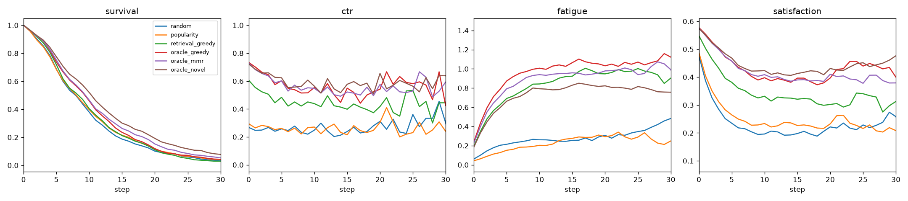
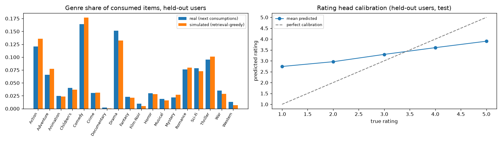

# Simulator validation report

Held-out users: 604  ·  candidates/step: 100  ·  slate size: 5  ·  calibrated `sim_ref`: 0.231

## Sanity checks

- PASS: choice model beats popularity NLL
- PASS: rating model beats global-mean RMSE
- PASS: greedy wins on immediate CTR (step 0)
- PASS: novelty-aware policy has longer sessions
- PASS: novelty-aware policy has more total watch
- PASS: every informed policy clicks more than random

## Learned model (held-out users, test positions)

| Model | Next-item NLL | HR@10 | Rating RMSE |
|---|---|---|---|
| Choice model | 5.556 | 0.290 | 0.970 |
| Popularity / global mean | 7.704 | – | 1.145 |

## Policies rolled through the simulator

`oracle_*` policies read the simulator's own learned affinity and exist only to probe the dynamics. No agent gets this access.

| Policy | Session len | Clicks | Watch | CTR | CTR@step0 | CTR after 10 | Watch/click | ILD | Fatigue | Genre H | Novelty | Coverage |
|---|---|---|---|---|---|---|---|---|---|---|---|---|
| random | 10.429 | 2.649 | 1.881 | 0.254 | 0.268 | 0.257 | 0.710 | 0.690 | 0.205 | 1.592 | 10.546 | 0.245 |
| popularity | 10.800 | 2.833 | 2.205 | 0.262 | 0.295 | 0.256 | 0.778 | 0.731 | 0.161 | 2.171 | 8.878 | 0.057 |
| retrieval_greedy | 10.780 | 5.142 | 3.515 | 0.477 | 0.606 | 0.429 | 0.684 | 0.585 | 0.666 | 1.815 | 10.134 | 0.240 |
| oracle_greedy | 11.603 | 6.853 | 4.698 | 0.591 | 0.733 | 0.535 | 0.686 | 0.582 | 0.820 | 1.910 | 10.283 | 0.300 |
| oracle_mmr | 12.233 | 7.237 | 4.975 | 0.592 | 0.730 | 0.542 | 0.687 | 0.640 | 0.756 | 1.997 | 10.265 | 0.305 |
| oracle_novel | 13.555 | 8.258 | 5.734 | 0.609 | 0.722 | 0.574 | 0.694 | 0.629 | 0.645 | 2.147 | 10.200 | 0.309 |

## Realism

Simulated sessions use the `retrieval_greedy` policy. Each user's real next consumptions are truncated to as many items as they clicked in simulation (mean 5.08; 486 users compared).

| Statistic | Real | Simulated |
|---|---|---|
| Genre entropy per user (bits) | 1.945 | 1.697 |
| Novelty of consumed items (bits) | 10.693 | 10.142 |

Genre-distribution JS divergence (real vs simulated): 0.0037 bits.

Rating calibration (held-out test): true 1 → 2.74 (n=631), true 2 → 2.96 (n=1208), true 3 → 3.30 (n=2629), true 4 → 3.61 (n=3143), true 5 → 3.90 (n=1726)

